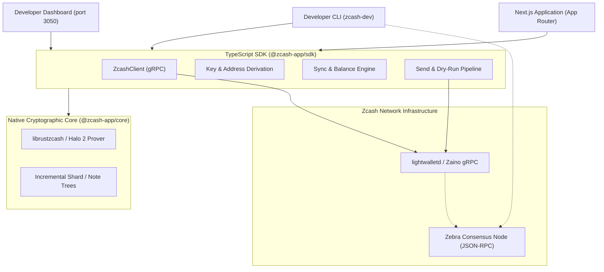

# Chapter 1: Introduction

Welcome to **`create-zcash-app`**, the developer toolkit for building full-stack, shielded Zcash web and server applications in TypeScript.

## What It Is

`create-zcash-app` is a modern development environment and application toolkit designed to make building shielded Zcash applications as intuitive and standard as scaffolding a modern web app. The monorepo provides:

1. **The Application Scaffolder (`create-zcash-app`)**: An interactive and scriptable CLI tool that bootstraps production-grade Next.js App Router applications pre-configured with Tailwind CSS, TypeScript, security guards, and Zcash SDK integration.
2. **The Developer Harness CLI (`zcash-dev`)**: A companion developer CLI that orchestrates local regtest devnets (supporting both Z3 NU6.3 and NU7 stacks), drives instant block generation and test funding, controls network switching, queries balances, and dry-runs shielded transactions.
3. **The TypeScript SDK (`@zcash-app/sdk`)**: A typed client SDK for connecting to lightwalletd/Zaino gRPC services, managing Unified Addresses and Unified Full Viewing Keys (UFVK), scanning compact blocks, verifying consensus branches, and submitting transactions.
4. **High-Performance Native Cryptographic Core (`@zcash-app/core`)**: Pre-compiled NAPI-RS Rust bindings that handle zero-knowledge proving (Halo 2), note commitment tree management, key derivation, and transaction serialization across macOS, Linux, and Windows.
5. **The Zcash Developer Dashboard**: A Next.js-based local management dashboard on `http://localhost:3050` providing real-time node synchronization metrics, block explorer lookups, wallet status, and faucet controls.

## What It Is Not

To understand where `create-zcash-app` fits in your engineering stack, it is equally important to understand what it is **not**:

- **Not a Consumer Wallet Product**: `create-zcash-app` is not an end-user consumer wallet like Zashi, Ywallet, or Zecwallet. It does not provide consumer iOS or Android applications, and it does not manage hosted customer accounts.
- **Not a Custodial Service**: `create-zcash-app` never custodies private keys or funds on external servers. All cryptographic keys are derived locally in your process memory or stored in local configuration files (`.env.local`) protected by operating system file permissions.
- **Not a Consensus Full Node**: The SDK connects as a light client to gRPC indexers (such as `lightwalletd` or `zainod`) and Zebra JSON-RPC endpoints. It does not replace consensus full nodes (`zebrad`), but rather bridges them to web application architectures.

## Who It Is For

`create-zcash-app` is built specifically for:

- **Web Developers & dApp Builders**: Developers building modern web interfaces that accept shielded Zcash payments or interact with Zcash accounts without writing low-level C or Rust bindings.
- **Merchants & E-Commerce Integrators**: Teams integrating non-custodial shielded checkout flows, invoice verification, and dynamic payment requests with ZIP-321 support.
- **Backend Engineers & Payment Processors**: Engineers deploying automated watch-only wallet monitors, transaction intake pipelines, or batch disbursement systems using Unified Full Viewing Keys (UFVK).
- **Zcash Researchers & Protocol Developers**: Builders testing consensus upgrade behaviors, cross-pool transfers (Sapling, Orchard, and Ironwood), and custom fee policies in isolated local devnets.

## Architectural Overview

The following diagram illustrates how the components of `create-zcash-app` interact:

In the next chapter, we will walk through the [Quickstart](./ch02-quickstart.md) to bootstrap your first application and send a payment on a local regtest devnet.

