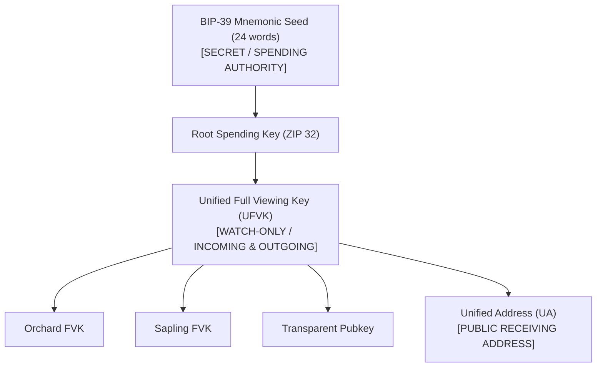

# Chapter 3: Concepts

To effectively build on Zcash with `create-zcash-app`, developers must understand the networks, consensus upgrades, shielded pools, and key hierarchies that govern shielded state.

---

## 1. Networks & Environments

Zcash operates across several distinct network contexts, each serving a specific phase of application development:

| Network | Chain ID / Network Name | Status & Purpose | Consensus Branch ID |
| :--- | :--- | :--- | :--- |
| **NU7 Regtest** | `regtest` | Isolated local devnet for NU7 testing (Zebra 7.0.0 + lightwalletd) | `0x77190ad9` |
| **Z3 NU6.3 Regtest** | `regtest` | Isolated local devnet with Zallet faucet (Zebra + Zaino + Zallet) | `0x5b331005` |
| **Testnet** | `testnet` | Public staging network (free testnet TAZ) | `0x77190ad9` (post-NU7) |
| **Mainnet** | `mainnet` | Production blockchain with real economic value | `0x77190ad9` (at activation) |

---

## 2. Consensus Upgrades: NU6.3, NU7, and Activation Heights

Consensus upgrades in Zcash are activated strictly by **block height**, not by timestamp or clock time.

### Network Upgrade 7 (NU7) Specifications

The specifications for Network Upgrade 7 (NU7) are defined in [ZIP 259: Network Upgrade 7](https://zips.z.cash/zip-0259) and [Zcash ZIPs PR #1405](https://github.com/zcash/zips/pull/1405) (as of November 2, 2026):

- **Consensus Branch ID**: `0x77190ad9`
- **Testnet Activation Height**: `4,465,026` (activated)
- **Testnet Canonical Activation Block Hash**: `000089ba27100beede16d64b34e3d1b626b428cb7ee9fe6dcfdc217ce24e78af`
- **Mainnet Activation Height**: `3,543,405`
- **Mainnet Activation Schedule**: Mainnet activation is strictly height-based, **expected around Nov 5–6, 2026 UTC** (as of November 2, 2026). Because activation depends on block arrival times governed by Proof of Work difficulty adjustments, it is an estimated window rather than a fixed calendar time.

### Why the NU7 Devnet Uses Zebra + lightwalletd (Not Zaino/Zallet)

Developers working with `zcash-dev` can select between two local regtest stacks:
- `--stack nu7` (Zebra 7.0.0 + lightwalletd)
- `--stack nu6` (Zebra + Zaino + Zallet RPC router)

Understanding why the NU7 path uses Zebra + lightwalletd instead of Zaino and Zallet is essential:

1. **Zallet beta.3 Lacks NU7 Support**: As documented in the upstream release of [Zallet v0.1.0-beta.3](https://github.com/zcash/zallet/releases/tag/v0.1.0-beta.3) (published August 26, 2026, read November 2, 2026), Zallet's latest stable release supports up to NU6.3 and cannot read Zebra v29 state format. When connected to a node activating NU7 (`0x77190ad9`), Zallet beta.3 warns `Pending incompatible network upgrades: Nu7 (branch ID 77190ad9, unrecognized)` and halts steady-state synchronization. Upstream PR #924 ([PR #924](https://github.com/zcash/zallet/pull/924), merged November 1, 2026) adds NU7 support in source, but is not yet included in a tagged release.
2. **Zaino 0.10.x Lacks NU7 Support**: As documented in the upstream release of [Zaino 0.10.1](https://github.com/zingolabs/zaino/releases/tag/0.10.1) (published September 29, 2026, read November 2, 2026), the 0.10.x release line does not recognize consensus branch `0x77190ad9`. On a chain activating NU7, Zaino 0.10.x logs `validator unavailable: deserialize: parse error: invalid consensus branch id`. While upstream PR #1658 ([PR #1658](https://github.com/zingolabs/zaino/pull/1658), merged October 12, 2026) added branch constants in source, it is not in a release; NU7 support remains tracked in open PR #1655 ([PR #1655](https://github.com/zingolabs/zaino/pull/1655)) and Issue #1731 ([Issue #1731](https://github.com/zingolabs/zaino/issues/1731)).
3. **Zebra 7.0.0 & lightwalletd Support NU7**: [Zebra 7.0.0](https://github.com/ZcashFoundation/zebra/releases/tag/v7.0.0) (published October 22, 2026, read November 2, 2026) and official `lightwalletd` include complete support for the NU7 consensus branch ID `0x77190ad9`. Therefore, `create-zcash-app` routes all NU7 development and testing through the Zebra + lightwalletd container stack.

---

## 3. Shielded Value Pools: Sapling, Orchard, and Ironwood

Zcash protects transaction metadata and amounts using zero-knowledge proofs across successive cryptographic pools:

### Transparent Pool (`t-addr`)
Legacy Bitcoin-style unshielded UTXOs (addresses starting with `t1` on mainnet, `tm` on testnet/regtest). Transparent transaction inputs and outputs expose sender, recipient, and amount publicly on-chain.

### Sapling Pool (`z-addr`)
Introduced in Network Upgrade 2 (2018), Sapling uses the Groth16 zero-knowledge proving system over the Jubjub elliptic curve (ZIP 205). Sapling addresses begin with `zs` (mainnet) or `ztestsapling` (testnet).

### Orchard Pool
Introduced in Network Upgrade 5 (2022, ZIP 224), Orchard eliminates trusted setups by using the Halo 2 recursive proving system over the Pasta curve cycle (Pallas and Vesta). Orchard transactions use unified actions that bundle spend and output capabilities into single primitives.

### Ironwood Pool (NU6.3 / NU7)
Introduced under [ZIP 258: Consensus rules from NU6.3 activation](https://zips.z.cash/zip-0258) and extended in [ZIP 259](https://zips.z.cash/zip-0259), Ironwood provides the next-generation transaction version 6 (`v6`) shielded pool:
- **Turnstile Policy**: Under ZIP 258, no new value may enter the Orchard pool after activation (`vOrchardPoolBalance >= 0`). Coinbase outputs cannot fund Orchard directly; new value transitions toward Ironwood.
- **Cross-Pool Transfers**: Wallets dynamically construct shielded transactions that manage transitions across pools with ZIP-317 fee protections.

---

## 4. Key Hierarchy: Spending Authority vs. Viewing Authority

`create-zcash-app` strictly separates **spending capability** from **viewing capability** in accordance with [ZIP 316: Unified Addresses and Unified Full Viewing Keys](https://zips.z.cash/zip-0316):

### Spending Authority (`ZCASH_MNEMONIC`)
- Formatted as a 12- or 24-word phrase drawn from the standard BIP-39 English wordlist.
- Required to sign and broadcast transactions via `zcash-dev send --yes`.
- Stored exclusively in `.env.local` or injected via runtime environment variables. It is never exposed over public APIs or written into `zcash.config.json`.

### Viewing Authority (`ZCASH_UFVK` / Watch-Only)
- Encoded as a `uview...` Bech32 string.
- Grants read-only visibility into the account: can decrypt incoming and outgoing notes, compute confirmed pool balances, and decode encrypted payment memos.
- **Zero Custody Risk**: Even if an application server or database is completely compromised, an attacker holding only a UFVK cannot spend or steal funds.
- Ideal for production backend order processors, donation trackers, and accounting monitors.

### Unified Addresses (UA)
- Encoded as `u1...` (mainnet) or `uregtest1...` / `utest1...` (testnet/regtest).
- Bundles multiple receiver types (transparent, Sapling, and Orchard) into a single address string. Senders automatically route payments to the most secure pool supported by both wallets.

