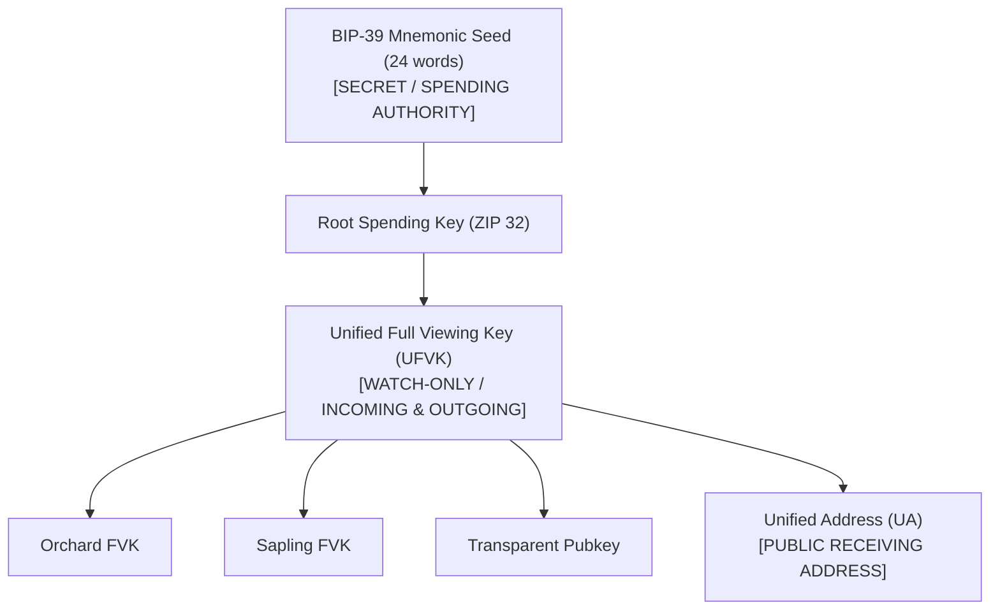

# Chapter 3: Concepts

To effectively build on Zcash with `create-zcash-app`, developers must understand the networks, consensus upgrades, shielded pools, and key hierarchies that govern shielded state.

---

## 1. Networks & Environments

Zcash operates across several distinct network contexts, each serving a specific phase of application development:

| Network | Chain ID / Network Name | Status & Purpose | Consensus Branch ID |
| :--- | :--- | :--- | :--- |
| **NU7 Regtest** | `regtest` | Isolated local devnet for NU7 testing (Zebra 7.0.0 + lightwalletd) | `0x77190ad9` |
| **Z3 NU6.3 Regtest** | `regtest` | Isolated local devnet with Zallet faucet (Zebra + Zaino + Zallet) | `0x5b331005` |
| **Testnet** | `testnet` | Public staging network (free testnet TAZ) | `0x77190ad9` (post-NU7) |
| **Mainnet** | `mainnet` | Production blockchain with real economic value | `0x77190ad9` (at activation) |

---

## 2. Consensus Upgrades: NU6.3, NU7, and Activation Heights

Consensus upgrades in Zcash are activated strictly by **block height**, not by timestamp or clock time.

### Network Upgrade 7 (NU7) Specifications

The specifications for Network Upgrade 7 (NU7) are defined in [ZIP 259: Deployment of the NU7 Network Upgrade (Proposed)](https://zips.z.cash/zip-0259) and its deployed consensus ZIPs:

- **Consensus Branch ID**: `0x77190ad9`
- **Testnet Activation Height**: `4,465,026` (activated)
- **Testnet Canonical Activation Block Hash**: `000089ba27100beede16d64b34e3d1b626b428cb7ee9fe6dcfdc217ce24e78af`
- **Mainnet Activation Height**: `3,543,405`
- **Mainnet Activation Schedule & Status**: NU7 activated on mainnet at block `3,543,405` on Nov 5, 2026 at 9:34 pm ET (02:34 UTC Nov 6, 2026), per [Unchained](https://unchainedcrypto.com/zcash-activates-nu7-taking-60-of-transaction-fees-out-of-circulation/), citing Blockchair. Mainnet node operators must run [Zebra 7.0.0](https://github.com/ZcashFoundation/zebra/releases/tag/v7.0.0) or later with network protocol version 170190 and database format v29.
- **Key Protocol Changes in NU7**:
  - **25s Block Target & Halving Intervals**: Target block spacing was reduced from 75 seconds to 25 seconds, tripling block production frequency, as specified in [ZIP 218: 25-second Block Target Spacing (Draft)](https://zips.z.cash/zip-0218). To preserve the long-term emission schedule, per-block block subsidies are divided by three, and post-NU7 halving intervals are tripled to 5,040,000 blocks (`PostNU7HalvingInterval = 5,040,000`).
  - **Shielded Action Limits**: As specified in [ZIP 218 (Draft)](https://zips.z.cash/zip-0218), NU7 *"introduces per-pool action limits for the Sapling, Orchard, and Ironwood shielded pools"* along with a global cap to bound synchronization costs and mitigate DoS vectors under faster block production: `GlobalShieldedBudget = 330`, `OrchardProtocolBlockActionLimit = 330` (applied to Orchard actions and Ironwood actions), `SaplingBlockIOLimit = 300`, and `SproutBlockJoinSplitLimit = 0`.
  - **Transaction Version 4 Deprecation & Sprout Freeze**: Support for version 4 (v4) transactions was disallowed; transactions must use version 5 (v5) or version 6 (v6 Ironwood), as specified in [ZIP 2003: Disallow version 4 transactions (Proposed)](https://zips.z.cash/zip-2003) and [ZIP 259 (Proposed)](https://zips.z.cash/zip-0259). Because Sprout transfers can only be represented in version 4 transactions, remaining funds in the Sprout pool can no longer be spent and are frozen at the protocol level.
  - **Network Sustainability Mechanism (NSM)**: Miners retain 40% of transaction fees, while 60% are removed from circulation to the NSM Value Balance, as specified in [ZIP 235: Remove 60% of Transaction Fees From Circulation (Draft)](https://zips.z.cash/zip-0235), [ZIP 233: Network Sustainability Mechanism: Removing Funds From Circulation (Draft)](https://zips.z.cash/zip-0233), and reported by [Unchained](https://unchainedcrypto.com/zcash-activates-nu7-taking-60-of-transaction-fees-out-of-circulation/). This is not a permanent destruction of funds; removed fees enter the NSM Value Balance and are intended to be reissued through future block subsidies. Per consensus, reissuance begins at `NSM_REISSUANCE_HEIGHT`: Mainnet block `8,939,664`, as specified in [ZIP 259 (Proposed)](https://zips.z.cash/zip-0259) and [ZIP 237: Halving-Preserving Issuance (Draft)](https://zips.z.cash/zip-0237), projected for ~2031.

### Why the NU7 Devnet Uses Zebra + lightwalletd (Not Zaino/Zallet)

Developers working with `zcash-dev` can select between two local regtest stacks:
- `--stack nu7` (Zebra 7.0.0 + lightwalletd)
- `--stack z3` (Zebra + Zaino + Zallet RPC router)

Understanding why the NU7 path uses Zebra + lightwalletd instead of Zaino and Zallet is essential:

1. **Zallet beta.4 Dropped Zaino and Requires Co-located zebrad**: [Zallet v0.1.0-beta.4](https://github.com/zcash/zallet/releases/tag/v0.1.0-beta.4) (published Nov 2, 2026, checked 2026-11-06; container image `zodlinc/zallet@sha256:682ba6f9a9931ac25f6a2eb2218f39e0bf5295c3cbe4d8dfa3fc275c34559506`) introduced NU7 support on Mainnet (height 3,543,405) and Testnet (height 4,465,026). However, PR #900 removed the `zaino` backend entirely. Zallet's `zebra` backend requires a co-located `zebrad >= 7.0.0` with Zebra's on-disk database format v29.0.0 and indexer gRPC endpoint. Note that Zebra's stock published Docker images (`zfnd/zebra:7.0.0`) omit the Cargo `indexer` build feature; while the gRPC endpoint responds to `indexer_listen_addr`, Zebra does not build the spending-transaction index on disk, so Zallet reads an empty spending-transaction index (disabling transparent spend tracking). Tracking issue [Zallet #890](https://github.com/zcash/zallet/issues/890) remains open/lagging. Zallet can no longer be paired with Zaino. Experimental standalone reproduction files are available in `packages/dev/docker/spikes/zallet-beta4/`.
2. **Zaino 0.10.x Stops at NU7**: Upstream [Zaino 0.10.1 and 0.10.2](https://github.com/zingolabs/zaino/releases/tag/0.10.1) cannot index past the pre-NU7 activation block. On chains activating NU7 (`0x77190ad9`), Zaino 0.10.x retries indefinitely with `validator unavailable: deserialize: parse error: invalid consensus branch id` (tracked in open [Zaino Issue #1731](https://github.com/zingolabs/zaino/issues/1731), open since Nov 1, 2026, checked 2026-11-06). The fix in [Zaino PR #1655](https://github.com/zingolabs/zaino/pull/1655) remains open, unmerged, and unreleased as of 2026-11-06.
3. **Zebra 7.0.0 & lightwalletd Support NU7**: [Zebra 7.0.0](https://github.com/ZcashFoundation/zebra/releases/tag/v7.0.0) (published October 22, 2026) and official `lightwalletd` include complete, verified support for the NU7 consensus branch ID `0x77190ad9`. Therefore, `create-zcash-app` routes all NU7 development and testing through the Zebra + lightwalletd container stack.

---

## 3. Shielded Value Pools: Sapling, Orchard, and Ironwood

Zcash protects transaction metadata and amounts using zero-knowledge proofs across successive cryptographic pools:

### Transparent Pool (`t-addr`)
Legacy Bitcoin-style unshielded UTXOs (addresses starting with `t1` on mainnet, `tm` on testnet/regtest). Transparent transaction inputs and outputs expose sender, recipient, and amount publicly on-chain.

### Sapling Pool (`z-addr`)
Introduced in Network Upgrade 2 (2018), Sapling uses the Groth16 zero-knowledge proving system over the Jubjub elliptic curve (ZIP 205). Sapling addresses begin with `zs` (mainnet) or `ztestsapling` (testnet).

### Orchard Pool
Introduced in Network Upgrade 5 (2022, ZIP 224), Orchard eliminates trusted setups by using the Halo 2 recursive proving system over the Pasta curve cycle (Pallas and Vesta). Orchard transactions use unified actions that bundle spend and output capabilities into single primitives.

### Ironwood Pool (NU6.3 / NU7)
Introduced under [ZIP 258: Consensus rules from NU6.3 activation](https://zips.z.cash/zip-0258) and extended in [ZIP 259](https://zips.z.cash/zip-0259), Ironwood provides the next-generation transaction version 6 (`v6`) shielded pool:
- **Turnstile Policy**: Under ZIP 258, no new value may enter the Orchard pool after activation (`vOrchardPoolBalance >= 0`). Coinbase outputs cannot fund Orchard directly; new value transitions toward Ironwood.
- **Cross-Pool Transfers**: Wallets dynamically construct shielded transactions that manage transitions across pools with ZIP-317 fee protections.

---

## 4. Key Hierarchy: Spending Authority vs. Viewing Authority

`create-zcash-app` strictly separates **spending capability** from **viewing capability** in accordance with [ZIP 316: Unified Addresses and Unified Full Viewing Keys](https://zips.z.cash/zip-0316):

### Spending Authority (`ZCASH_MNEMONIC`)
- Formatted as a 12- or 24-word phrase drawn from the standard BIP-39 English wordlist.
- Required to sign and broadcast transactions via `zcash-dev send --yes`.
- Stored exclusively in `.env.local` or injected via runtime environment variables. It is never exposed over public APIs or written into `zcash.config.json`.

### Viewing Authority (`ZCASH_UFVK` / Watch-Only)
- Encoded as a `uview...` Bech32 string.
- Grants read-only visibility into the account: can decrypt incoming and outgoing notes, compute confirmed pool balances, and decode encrypted payment memos.
- **Zero Custody Risk**: Even if an application server or database is completely compromised, an attacker holding only a UFVK cannot spend or steal funds.
- Ideal for production backend order processors, donation trackers, and accounting monitors.

### Unified Addresses (UA)
- Encoded as `u1...` (mainnet) or `uregtest1...` / `utest1...` (testnet/regtest).
- Bundles multiple receiver types (transparent, Sapling, and Orchard) into a single address string. Senders automatically route payments to the most secure pool supported by both wallets.

